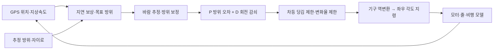

# 센서 기반 목표 추종과 PD 제어

구현은 [`TargetPD`](../simulation/guidance.py)에 있다. 제어기는 물리 모델과 분리돼 있고, 타임스탬프가 있는 관측 묶음을 입력받아 좌우 회전각 지령과 제어 로그를 반환한다.



## 입력과 유효성

- GPS: 동·북 위치 [m], 동·북 지상속도 [m/s], 샘플 시각 [s].
- IMU 관측: 이미 추정된 방위 [rad], 자이로 선회율 [rad/s]. 원시 IMU 융합은 이 코드 밖의 가정이다.
- 기압 고도: 고도 [m]와 유효 상태. 현재는 신선도 검사에 사용하고 최종 접근 제어에는 쓰지 않는다.
- 세 센서 중 하나라도 `sensor_timeout_s`보다 오래되면 좌우 중립 지령을 낸다. 이는 시험용 대응 정책이다.

센서 지연 동안 마지막 도착 패킷을 유지한다. `controller_period_s`는 제어 스케줄이고 물리 적분 간격은 `dt_s`다. 갱신은 적분 시점에서 일어나므로 두 주기의 비가 정수가 아니면 실제 갱신 간격이 번갈아 나타난다. 정확한 갱신 시각은 `control_log.csv`에 남는다.

## 목표 방위

북쪽이 0°, 동쪽이 +90°다. GPS 지연은 측정한 지상속도로 외삽한다.

```text
현재 위치 추정 = GPS 위치 + GPS 속도 × GPS 측정 나이
목표 오차 = 목표 위치 − 현재 위치 추정
목표 방위 = atan2(동쪽 오차, 북쪽 오차)
```

바람은 GPS 속도에서 **가정한 수평 대기속도 × 추정 방위**를 빼고 저역통과한다. 실제 풍속을 알고 있는 것이 아니다. 목표 방위에 직각인 바람 성분을 이용해 지령 방위를 보정한다. 추정 오차가 있으므로 도달 불가 표시는 참고 판단이다.

## PD와 당김 지령

```text
e = wrap(지령 방위 − 측정 방위)              [rad, −π ~ π)
P = navigation_kp_s_inv × e                 [rad/s]
D = −navigation_kd × 측정 선회율            [rad/s]
요구 선회율 = P + D
요구 차등 당김 = 요구 선회율 / controller_turn_gain_rad_s_m   [m]
```

D 항은 방위 오차를 수치 미분하는 대신 **측정 선회율에 감쇠를 적용**한다. 목표 방위가 갑자기 바뀔 때 미분 지령이 튀는 것을 줄이기 위한 구조다. 적분 항은 없다. 현재 구현에서 `navigation_kp_s_inv`는 이름과 달리 거리 오차에 곱하는 계수가 아니라 **방위 오차의 P 이득**이다.

차등 당김을 `control_brake_limit_m`로 제한한 후 `brake_slew_m_s`로 변화율을 제한한다. 양수면 오른쪽, 음수면 왼쪽을 당기고 반대쪽은 중립이다.

`controller_turn_gain_rad_s_m`는 제어기가 믿는 보정값이고, `turn_gain_rad_s_m`은 물리 모델이 실제로 사용하는 값이다. 둘을 다르게 설정하면 잘못된 보정의 영향을 시험할 수 있다. 제어기 보정값은 0일 수 없지만 물리 모델의 선회 효과는 0도 허용한다.

## 당김량을 모터 각도로 변환

[`brake_to_angle()`](../simulation/guidance.py)은 정적 하중을 가정한 선행 보상이다.

```text
F0 = 가정 질량 × g × 조향줄 하중 비율 / 2
필요 줄 이동량 = 유격 + 당김량 + (F0 + 당김 강성 × 당김량) / 줄 강성
모터 각도 = 필요 줄 이동량 × 도르래 비율 / 드럼 반지름
```

동적 공기력을 직접 읽지 않기 때문에 실제 당김과 지령 당김은 다를 수 있다. 실제 모터는 지연·부하·가감속을 거친다. `left/right_command_deg`, `left/right_applied_target_deg`, `left/right_angle_deg`, `left/right_brake_m`을 구분해 비교한다.

## 코드 수정 시 확인할 것

1. 센서 무효·오래된 패킷에서 중립 동작이 유지되는가.
2. ±180° 경계의 방위 오차가 짧은 방향으로 계산되는가.
3. 좌우 부호가 실제 기구 연결과 맞는가.
4. 당김·각도·변화율 제한과 지령 포화 로그가 유지되는가.
5. 실제 모델의 참 위치·풍속이 제어 입력에 섞이지 않는가.

[`test_guidance.py`](../simulation/tests/test_guidance.py)가 부호·래핑·감쇠·포화·센서 끊김·복구를 검사한다. 시뮬레이션 이득을 그대로 비행 보드에 복사하기 전에 서보·기구·캐노피 응답을 측정해야 한다. 이 저장소에는 비행 보드 통신이나 실물 조향 펌웨어가 포함되지 않는다.
